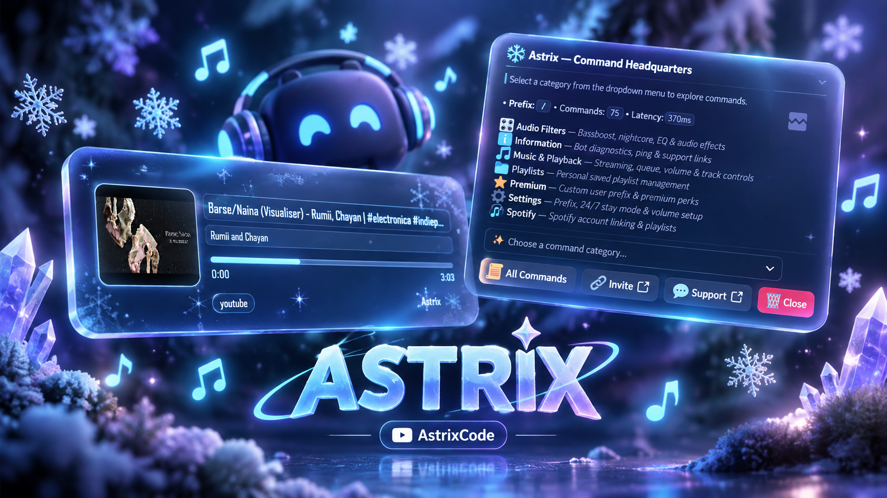

<p align="center">
  
  
  
  
</p>

# 🎵 Astrix

**Astrix** is a powerful and versatile Discord music bot built with Discord.js, featuring advanced sharding capabilities and a modular command architecture. Designed for high-performance music streaming and comprehensive queue management, Astrix brings premium audio experiences to your Discord server.

## ✨ Key Features

### 🎶 Music Playback

- **Multi-Platform Support:** Stream music from YouTube, Spotify, Apple Music, and SoundCloud
- **High-Quality Audio:** Powered by Lavalink for superior sound quality
- **Audio Filters:** Enhance your listening experience with filters like bassboost, nightcore, and vaporwave

### 📋 Queue Management

- **Advanced Controls:** Shuffle, clear, remove, and move tracks with ease
- **History Tracking:** Keep track of previously played songs
- **Queue Limits:** Free (50 songs) and Premium (200 songs) tiers

### 🎨 Customization

- **Custom Playlists:** Create and manage personal playlists
- **User Prefixes:** Premium users can set custom command prefixes
- **24/7 Mode:** Keep the bot in your voice channel around the clock

### 🚀 Performance

- **Hybrid Sharding:** Scalable architecture for handling multiple servers
- **Optimized Database:** Fast data access with Better-SQLite3
- **Auto-Reconnection:** Reliable connection management with automatic recovery

## 🛠️ Technologies Used

- **[Discord.js](https://discord.js.org/)** - Discord API library
- **[discord-hybrid-sharding](https://github.com/meister03/discord-hybrid-sharding)** - Advanced sharding system
- **[Lavalink](https://github.com/lavalink-devs/Lavalink)** - Audio streaming server
- **[lavalink-client](https://github.com/Tomato6966/lavalink-client)** - Lavalink client implementation
- **[Better-SQLite3](https://github.com/WiseSource/better-sqlite3)** - Fast SQLite database

## 📦 Setup Instructions

### Prerequisites

- Node.js v16.9.0 or higher
- A Discord Bot Token ([Get one here](https://discord.com/developers/applications))
- A running Lavalink server

### Installation

1. **Clone the repository:**

   ```bash
   git clone https://github.com/AstrixCode/Astrix.git
   cd Astrix
   ```

2. **Install dependencies:**

   ```bash
   npm install
   ```

3. **Configure environment variables:**

   Create a `.env` file in the project root:

   ```bash
   cp .env.example .env
   ```

   Edit `.env` with your configuration:

   ```env
   # Required
   DISCORD_TOKEN=your_bot_token_here
   CLIENT_ID=your_client_id_here
   OWNER_IDS=your_user_id_here

   # Lavalink Configuration
   LAVALINK_HOST=localhost
   LAVALINK_PORT=2333
   LAVALINK_PASSWORD=youshallnotpass

   # Optional: Spotify Integration
   SPOTIFY_CLIENT_ID=your_spotify_client_id
   SPOTIFY_CLIENT_SECRET=your_spotify_client_secret

   # Optional: Last.fm Integration
   LASTFM_API_KEY=your_lastfm_api_key
   ```

4. **Set up Lavalink:**

   Download and configure Lavalink:
   - Download the latest Lavalink.jar from [Lavalink Releases](https://github.com/lavalink-devs/Lavalink/releases)
   - Create an `application.yml` configuration file
   - Start Lavalink: `java -jar Lavalink.jar`

   Ensure Lavalink is running and accessible before starting the bot.

5. **Start the bot:**

   For production:

   ```bash
   npm start
   ```

   For development (with hot-reloading):

   ```bash
   npm run dev
   ```

## 📝 Configuration Guide

### Environment Variables

| Variable                | Description                    | Required | Default     |
| ----------------------- | ------------------------------ | -------- | ----------- |
| `DISCORD_TOKEN`         | Your Discord bot token         | ✅ Yes   | -           |
| `CLIENT_ID`             | Discord application client ID  | ✅ Yes   | -           |
| `PREFIX`                | Command prefix                 | ❌ No    | `.`         |
| `OWNER_IDS`             | Comma-separated owner user IDs | ✅ Yes   | -           |
| `LAVALINK_HOST`         | Lavalink server host           | ✅ Yes   | `localhost` |
| `LAVALINK_PORT`         | Lavalink server port           | ✅ Yes   | `2333`      |
| `LAVALINK_PASSWORD`     | Lavalink server password       | ✅ Yes   | -           |
| `SPOTIFY_CLIENT_ID`     | Spotify API client ID          | ❌ No    | -           |
| `SPOTIFY_CLIENT_SECRET` | Spotify API client secret      | ❌ No    | -           |
| `LASTFM_API_KEY`        | Last.fm API key                | ❌ No    | -           |

See `.env.example` for the complete list of configuration options.

## 🎯 Commands

### Music Commands

- `play <song>` - Play a song or add it to queue
- `pause` - Pause the current track
- `resume` - Resume playback
- `skip` - Skip to the next song
- `stop` - Stop playback and clear queue
- `queue` - Display the current queue
- `nowplaying` - Show currently playing track

### Queue Management

- `shuffle` - Shuffle the queue
- `clear` - Clear the entire queue
- `remove <position>` - Remove a song from queue
- `move <from> <to>` - Move a song in the queue

### Playlist Commands

- `playlist create <name>` - Create a new playlist
- `playlist add <name>` - Add current song to playlist
- `playlist play <name>` - Play a saved playlist

### Filter Commands

- `filter bassboost` - Apply bassboost effect
- `filter nightcore` - Apply nightcore effect
- `filter vaporwave` - Apply vaporwave effect
- `filter clear` - Remove all filters

## 📄 Example .env File

Here's a complete example of a configured `.env` file:

```env
# ====================================
# DISCORD BOT CONFIGURATION
# ====================================
DISCORD_TOKEN=
CLIENT_ID=1031120600858624000
PREFIX=!
OWNER_IDS=owner,owner

# ====================================
# LAVALINK CONFIGURATION
# ====================================
LAVALINK_HOST=localhost
LAVALINK_PORT=2333
LAVALINK_PASSWORD=youshallnotpass
LAVALINK_SECURE=false

# ====================================
# SPOTIFY API
# ====================================
SPOTIFY_CLIENT_ID=
SPOTIFY_CLIENT_SECRET=

# ====================================
# LAST.FM API (Optional) [required for recommendations and autoplay
# ====================================
LASTFM_API_KEY=

# ====================================
# BOT STATUS CONFIGURATION
# ====================================
STATUS_TEXT=!help | Music Bot 🎵
STATUS_TYPE=online

# ====================================
# WEBHOOK LOGGING (Optional)
# ====================================
WEBHOOK_ENABLED=true
WEBHOOK_URL=https://discord.com/api/webhooks/123456789/abcdefghijklmnopqrstuvwxyz
WEBHOOK_USERNAME=Astrix Logger
WEBHOOK_AVATAR_URL=https://i.imgur.com/yourimage.png
WEBHOOK_INFO_ENABLED=true
WEBHOOK_SUCCESS_ENABLED=true
WEBHOOK_WARNING_ENABLED=true
WEBHOOK_ERROR_ENABLED=true
WEBHOOK_DEBUG_ENABLED=false

# ====================================
# ASSETS (required or some some cmds eill fail)
# ====================================
DEFAULT_TRACK_ARTWORK=https://i.imgur.com/track-artwork.jpg
DEFAULT_THUMBNAIL=https://i.imgur.com/thumbnail.jpg
HELP_THUMBNAIL=https://i.imgur.com/help-thumbnail.jpg

# ====================================
# EXTERNAL LINKS
# ====================================
SUPPORT_SERVER_URL=https://discord.gg/yourinvite

# ====================================
# ENVIRONMENT
# ====================================
NODE_ENV=production
DEBUG=false
```

> **⚠️ Security Warning:** Never commit your `.env` file to version control! Always keep your tokens and API keys private.

## 🚨 Important Notes

- **Under Development:** This project is actively being developed. Expect potential bugs and breaking changes.
- **Report Issues:** Found a bug? Please report it on the [GitHub Issues](https://github.com/AstrixCode/Astrix/issues) page.
- **Public Hosting:** Hosting a public instance without permission is prohibited.
- **Credits:** Do not remove or modify the project credits.

## 🤝 Contributing

Contributions are welcome! Please feel free to submit a Pull Request. For major changes, please open an issue first to discuss what you would like to change.

## 👥 Credits

- **Original Base & Architecture:** Developed & Created by **CodeX Development**
- **Maintained & Customized By:** **Vinay Kumar** ([AstrixCode](https://github.com/AstrixCode))
- Special thanks to the open-source community and all contributors!

---

<p align="center">
  Original codebase by <b>CodeX Development</b> • Maintained & customized with ❤️ by <a href="https://github.com/AstrixCode">Vinay Kumar (AstrixCode)</a>
</p>

<p align="center">
  <a href="https://discord.gg/zqxWVH3CvG">Support Server</a> •
  <a href="https://github.com/AstrixCode/Astrix/issues">Report Bug</a> •
  <a href="https://github.com/AstrixCode/Astrix/issues">Request Feature</a>
</p>
